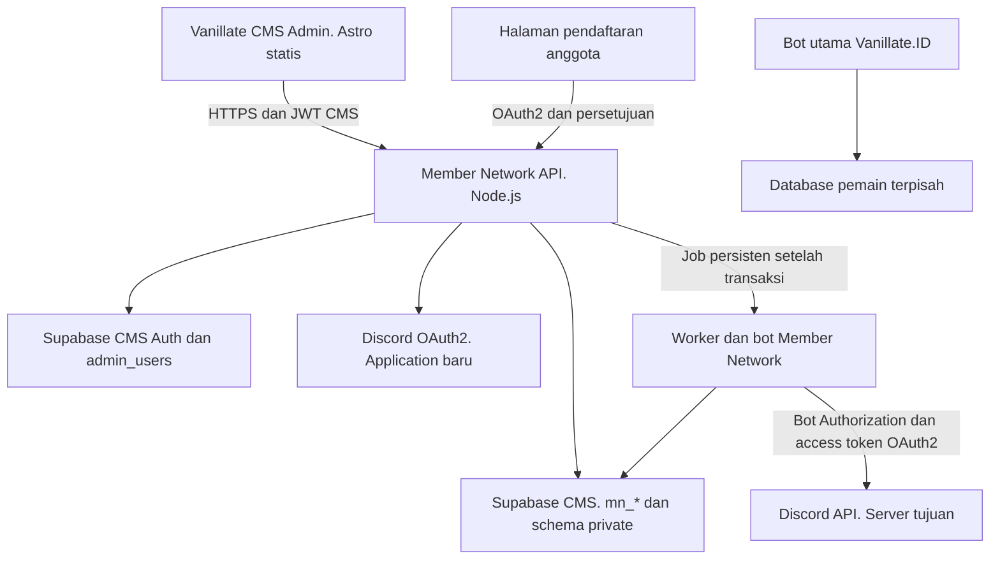

# Stage 1. Audit dan rancangan arsitektur

> Catatan historis sebelum implementasi. Status terbaru, keputusan implementasi dan batas verifikasi ada di [implementation.md](implementation.md).

Tanggal: 16 November 2026, WIB. Status: rancangan untuk ditinjau, bukan implementasi terverifikasi.

## 1. Lingkup dan bukti audit

Audit dilakukan pada checkout lokal dan metadata database CMS melalui SELECT saja. Tidak membaca data member, token, atau secret. Tidak membuat project Supabase, aplikasi Discord, tabel, migration, atau deployment.

| Komponen                  | Hasil                                                                                                                                              |
| ------------------------- | -------------------------------------------------------------------------------------------------------------------------------------------------- |
| Repository Member Network | Kloning sukses, remote Ndyspleasure/Vanillate-Member-Network, belum memiliki commit atau kode                                                      |
| Website CMS               | Astro, Tailwind, TypeScript dan Supabase; hosting statis                                                                                           |
| Bot utama                 | Node.js, discord.js dan PostgreSQL; runtime terpisah                                                                                               |
| Database CMS              | Infrastruktur CMS existing; identitas deployment tidak dipublikasikan                                                                              |
| Database pemain           | Terpisah dari CMS dan tidak digunakan layanan baru                                                                                                 |
| Model admin               | `public.admin_users`, id UUID, username, display_name, role, last_login_at, created_at; role owner/admin/viewer                                    |
| Integrasi lama            | `bot_commands`, `bot_panel_snapshots`, partnership*campaigns, guild*\_ dan share\_\_ sudah ada; tidak digunakan ulang untuk pekerjaan layanan baru |
| Namespace baru            | Tidak ditemukan tabel public dengan prefix literal `mn_`; pengecekan ulang wajib sebelum migration                                                 |

Acuan yang dibaca: CLAUDE.md bot dan website, claudereport.md bot, package.json kedua repo, astro.config.mjs, src/lib/supabase.ts, src/lib/admin-auth.ts, src/lib/admin-menu.ts, supabase/schema.sql, supabase/functions/cms-read/index.ts dan logic.ts, docs/ADMIN-CMS.md. Dokumen panjang dibaca bertahap; beberapa keluaran alat terpotong sehingga inventaris ini tidak dianggap audit seluruh kode atau semua instruksi baris demi baris yang belum tampil penuh.

Papan handover mencatat HO-031 (kuota egress dan log), BUG-018 (bridge SQL sinkron memblokir event loop), PLAN-001 (sisa tabel dashboard lama di CMS), dan PLAN-006 (baca sesuai permintaan). Karena itu jangan menyalin bridge sinkron, polling snapshot, atau tabel guild/share lama ke layanan baru. Checkout lokal belum dibandingkan dengan HEAD produksi.

## 2. Prasyarat keamanan sebelum integrasi

Model otorisasi CMS perlu ditinjau dan diuji di lingkungan terisolasi sebelum layanan baru diaktifkan. Detail audit keamanan disimpan pada catatan internal, tidak dimuat dalam dokumentasi publik. Perubahan hak akses harus diuji dengan skenario negatif dan regresi login.

## 3. Keputusan arsitektur

1. Repository terpisah untuk API, bot, worker, migration layanan, dan dokumentasi; halaman admin ditambahkan kelak di repo website. Tidak mengimpor runtime bot utama.
2. Usulan stack backend: Node.js 24 LTS, TypeScript, Fastify, discord.js, supabase-js. Pin versi aktual dan commit lockfile saat Stage 2; belum menginstal dependency.
3. Gunakan Supabase CMS yang sudah ada untuk data layanan ini sebagai integrasi CMS, bukan data gameplay. Prefix `mn_` di public untuk metadata layanan; schema non-exposed `member_network_private` untuk kredensial dan state sensitif. Penggunaan CMS berbagi kuota dan harus diukur sebelum peluncuran.
4. API dan worker dapat dijalankan sebagai dua proses Node terpisah dalam satu deployment layanan. Bot memiliki application, token, konfigurasi dan supervisor sendiri. Backend tidak membutuhkan bot utama hidup.
5. CMS memanggil HTTPS API baru langsung dengan JWT Supabase CMS. Backend memverifikasi token melalui Supabase Auth dan membaca role aktual, tidak mempercayai role/body browser atau user_metadata. Mutasi sensitif memeriksa role tanpa cache.
6. Migrasi domain mn\_\* dimiliki repo Member Network. Tidak menduplikasi DDL di website. Perubahan izin admin_users dimiliki repo website sebagai perbaikan tersendiri.

Tidak ada panah ketergantungan dari layanan baru ke bot utama atau database pemain.

## 4. OAuth2 dan auto-join

Koreksi pemilik: `guilds.join` diizinkan. Registrasi dasar memakai `identify`; fitur auto-join meminta `identify guilds.join` lewat Authorization Code Flow. Scope `guilds` hanya ditambahkan kelak bila pemilih server admin benar-benar memerlukannya. Instalasi bot terpisah memakai `bot applications.commands`, permission minimum, tanpa Administrator.

Alur yang diusulkan:

1. Admin membuat tautan pendaftaran sekali pakai dari CMS; pemilik akun Discord sendiri membuka tautan dan menyetujui OAuth2. Admin tidak dapat memberikan persetujuan atas nama orang lain.
2. Backend menerbitkan state acak sekali pakai, masa berlaku 10 menit, disimpan sebagai hash dan terikat sesi browser serta tujuan pendaftaran. Redirect URI exact allowlist; tidak membawa JWT atau token ke query URL.
3. Callback memvalidasi state sebelum menukar code di backend, meminta `/users/@me`, memverifikasi scope yang diberikan, dan upsert identitas secara idempoten. Bersihkan URL callback, larang pencatatan query/code/token, gunakan respons no-store.
4. Catat persetujuan auto-join terpisah dari OAuth: komunitas tujuan atau kelompok komunitas yang dijelaskan jelas, batas frekuensi, versi penjelasan, waktu persetujuan, masa berlaku dan cara berhenti. Default awal: persetujuan per komunitas. Pendaftaran saja tidak dianggap persetujuan bergabung ke semua campaign masa depan.
5. Worker mengecek ulang koneksi aktif, persetujuan belum dicabut, campaign aktif, komunitas disetujui, bot terpasang dan izin server sebelum eksekusi. Jangan menjadwalkan auto-join massal saat baru mendaftar.
6. Rencana operasi resmi: `PUT /guilds/{guild.id}/members/{user.id}` memakai Authorization bot dan OAuth2 access_token pengguna pada body. Bot dan OAuth client harus berasal dari application yang sama; bot harus sudah berada di server tujuan. Verifikasi persyaratan permission terkini, termasuk CREATE_INSTANT_INVITE, lewat dokumentasi resmi sebelum implementasi.
7. Bedakan member baru, sudah menjadi member, membership screening pending, ditolak/banned, token dicabut/kedaluwarsa, bot tidak terpasang, dan rate limit. Screening tetap diselesaikan pengguna; jangan dihitung selesai sebelum definisi metrik terpenuhi.
8. Refresh token dilakukan server-side dengan lock per koneksi dan penyimpanan rotasi atomik. invalid_grant menghentikan pekerjaan dan meminta sambung ulang. Tidak menggunakan token akun biasa/self-bot.

OAuth scope bukan izin bot dan bukan privileged Gateway intent. Mulai dengan intent Guilds; kebutuhan GuildMembers hanya untuk event membership/retensi yang dibuktikan perlu dan tersedia. Auto-join REST tidak menjadi alasan meminta Message Content.

Disconnect: tandai koneksi dicabut dan hentikan job dahulu, revoke grant Discord dengan kredensial backend, hapus ciphertext token, simpan hasil audit minimum. Kegagalan revoke jaringan masuk retry terbatas; status lokal tetap melarang join. Pencabutan tidak otomatis mengeluarkan member dari server yang sudah diikuti. Hindari auto-rejoin setelah pengguna keluar tanpa persetujuan baru.

## 5. Model data konseptual, belum DDL

| Entitas                   | Data dan batasan utama                                                                                                              |
| ------------------------- | ----------------------------------------------------------------------------------------------------------------------------------- |
| mn_members                | UUID, Discord ID text unik, username, registered_at, connection_status terpisah dari account_status, disconnected_at                |
| private.oauth_connections | member_id unik, scopes, access/refresh ciphertext, nonce/tag/key_version, expires_at, revoked_at; tidak ada token plaintext         |
| private.oauth_states      | state_hash unik, session binding, tujuan, expires_at, consumed_at                                                                   |
| mn_communities            | guild_id text unik, nama, deskripsi, tags, bahasa, status tinjauan, bot presence, verified_admin_id                                 |
| mn_community_admins       | komunitas dan identitas pengelola, sumber dan waktu verifikasi izin Discord; jangan menerima guild_id sebagai bukti admin           |
| mn_member_interests       | member_id, tag; unik pasangan                                                                                                       |
| mn_join_consents          | member, komunitas, versi penjelasan, granted_at, expires_at, revoked_at                                                             |
| mn_campaigns              | komunitas, target tags/bahasa, jadwal, status draft/approved/running/paused/completed, batas jumlah dan laju                        |
| private.join_jobs         | idempotency key, consent_id, campaign_id, member_id, status, attempts, next_attempt_at, lease_until; unik campaign/member/komunitas |
| mn_join_results           | job_id unik, hasil added/already_member/pending/failed/unknown, kode error aman, waktu                                              |
| mn_analytics_daily        | agregat campaign/tanggal/event, tanpa token atau isi profil                                                                         |
| mn_audit_logs             | aktor, aksi, objek, hasil, request_id, timestamp; tidak memuat code, token atau body mentah                                         |

Kunci relasi, check status, indexes cursor pagination dan FK ditentukan dalam migration setelah inspeksi ulang schema. Simpan Discord snowflake sebagai text agar tidak kehilangan presisi JavaScript.

RLS aktif pada seluruh tabel baru; private schema tidak diekspos dan privileges anon/authenticated dicabut. Browser tidak membaca tabel token atau menulis tabel layanan langsung. Untuk metadata, default akses browser ditutup, semua melalui API yang terotorisasi. API menggunakan JWT pengguna untuk pemeriksaan admin/RLS, dan akses server terpisah untuk transaksi worker. Service role melewati RLS: setiap jalur privileged wajib memiliki otorisasi eksplisit. Usulan peningkatan: role DB khusus layanan dengan grants terbatas, agar kompromi backend tidak membuka seluruh CMS.

## 6. API dan CMS yang direncanakan

Prefix `/v1/member-network`. Semua list cursor pagination, batas default 25, maksimum 100, field allowlist. ID divalidasi; operasi ditulis ke audit. Error terstruktur dengan request_id, tanpa stack/secret.

| Kelompok  | Operasi                                                    | Izin                                                                       |
| --------- | ---------------------------------------------------------- | -------------------------------------------------------------------------- |
| OAuth     | POST /registrations, GET /oauth/start, GET /oauth/callback | Admin membuat tautan; pemilik Discord menyetujui melalui sesi sekali pakai |
| Member    | GET /members, GET /members/:id/activity                    | owner/admin; viewer hanya agregat tanpa identitas                          |
| Member    | PATCH /members/:id/status, POST /members/:id/disconnect    | owner/admin; pemilik akun juga dapat disconnect melalui sesi anggota       |
| Community | GET/POST/PATCH /communities                                | admin CMS; klaim pengelola server perlu verifikasi Discord                 |
| Campaign  | GET/POST/PATCH /campaigns                                  | owner/admin; mulai/jeda perlu pemeriksaan ulang dan audit                  |
| Consent   | POST/DELETE /me/consents/:communityId                      | pemilik akun; admin tidak dapat memalsukan persetujuan                     |
| Catalog   | GET /catalog, GET /me/recommendations                      | hanya komunitas disetujui; rekomendasi personal perlu sesi anggota         |
| Analytics | GET /analytics                                             | agregat owner/admin/viewer; tanpa daftar identitas                         |
| Health    | GET /health/live, GET /health/ready                        | output publik minimum, detail operasi khusus owner                         |

Halaman rencana di website: `/admin/member-network`, `/members`, `/communities`, `/campaigns`, `/analytics` di bawah prefix admin tersebut. Gunakan guard dan menu admin yang ada, esc() untuk data Discord, fetch ke API lewat konfigurasi publik URL saja. Jangan mengirim bearer CMS pada domain selain origin API yang ditentukan. Halaman anggota terpisah dari CMS admin, walaupun menggunakan website yang sama; sesi anggota opaque HttpOnly di backend, bukan akun admin baru.

CORS origin exact vanillate.id dan localhost dev yang eksplisit. Cookie OAuth/anggota Secure HttpOnly SameSite sesuai alur, anti-CSRF untuk mutasi cookie, pemeriksaan Origin. JWT admin melalui header Authorization. Tidak ada secret di build Astro/GitHub Pages.

## 7. Worker, rekomendasi, analitik dan biaya

Job persisten dibuat dalam transaksi bersama audit, lalu worker dibangunkan setelah commit. Tanpa polling idle cepat. Pemulihan restart memakai pemindaian bounded saat boot dan timer terdekat next_attempt_at; fallback sweep jarang untuk job yang kehilangan notifikasi, misalnya 15 menit, 96 kueri/hari/proses maksimum saat idle. Lock/lease SQL atomik mencegah worker ganda; lease habis dapat dipulihkan. Periksa consent tepat sebelum request Discord dan gunakan lock/status untuk menyelaraskan disconnect dengan job; request yang sudah diterima Discord tidak dapat ditarik kembali.

Discord dan DB tidak berbagi transaksi. Jika request timeout sesudah Discord menerima join, status unknown perlu rekonsiliasi, bukan dihitung sebagai kegagalan atau konversi baru. Hormati retry_after dan limit global/per-route, backoff berjitter, maksimum percobaan, dead-letter untuk peninjauan. POST administratif wajib idempotency key. Kill switch layanan dan campaign diperiksa sebelum setiap join.

Rekomendasi awal deterministik: kecocokan tags dan bahasa, komunitas aktif/disetujui, pengecualian yang ditolak pengguna atau diketahui sudah diikuti. Tidak memakai ML atau AI eksternal. Simpan alasan rekomendasi tanpa menyimpan aktivitas Discord yang tidak diperlukan.

Analitik memisahkan impressions, klik, persetujuan, added, already_member, pending, failed, unknown. already_member bukan konversi. Retensi member tidak diklaim tanpa observasi yang memadai. Deduplikasi event dan transaksi increment agregat; laporan CMS sesuai permintaan dengan cache agregat 60 detik, tanpa polling UI atau snapshot push.

Anggaran awal untuk diuji: 1.000 join/hari dengan 4 sampai 8 operasi DB/job menghasilkan 4.000 sampai 8.000 operasi ditambah audit, OAuth dan retry; 20 pembukaan daftar/hari x 25 profil x kira-kira 1 KB sekitar 0,5 MB response payload sebelum overhead. Ini perkiraan desain, bukan pengukuran kuota/billing. Hard cap campaign, pagination, batas concurrency awal 1 sampai 2 dan alarm jumlah job/egress diperlukan.

Usulan retensi: state OAuth 10 menit lalu cleanup harian; token hanya selama koneksi aktif; aktivitas rinci 30 hari; audit operasional 90 hari; agregat anonim lebih lama sesuai kebutuhan. Durasi ini usulan yang harus dikonfirmasi melalui kebijakan layanan sebelum publikasi. Backup ciphertext tetap memerlukan kebijakan expiry dan pemulihan revocation.

## 8. Secret dan operasi

Env dari brief disiapkan kelak dengan nilai kosong: DISCORD_APPLICATION_ID, DISCORD_CLIENT_ID, DISCORD_CLIENT_SECRET, DISCORD_BOT_TOKEN, DISCORD_PUBLIC_KEY, DISCORD_REDIRECT_URI, SUPABASE_URL, SUPABASE_SERVICE_ROLE_KEY, APP_BASE_URL, PORT.

Tambahan yang diperlukan rancangan: SUPABASE_PUBLISHABLE_KEY untuk jalur JWT, CMS_ORIGIN, TOKEN_ENCRYPTION_KEY, TOKEN_ENCRYPTION_KEY_VERSION, MEMBER_SESSION_SECRET. Token dienkripsi AEAD AES-256-GCM dengan nonce unik dan associated data member/application; key di secret manager/env backend, bukan database atau repo. Rotasi dengan key_version, backup key terkontrol, fail closed bila secret tidak lengkap. DISCORD_PUBLIC_KEY hanya dipakai jika menerima HTTP interactions, bukan pengganti verifikasi OAuth.

Logging allowlist saja, redaksi Authorization, cookie, OAuth code/state, token dan body callback. Validasi request dan ukuran body, rate limit IP + aktor, timeout upstream, TLS dan graceful shutdown. Rate limit harus dibagi antar replika bila deployment diperbesar. Jangan meminta user menempel secret di chat.

Deploy rencana ke proses Node tersendiri (host dipilih kemudian), user OS dan PM2/service name sendiri; bot utama tidak direstart. Callback HTTPS pada API baru didaftarkan exact di Discord Developer Portal. App ID diverifikasi sama dengan Client ID dan identitas bot. Tidak mengubah OAuth aplikasi utama atau konfigurasi Auth Discord Database Bot.

## 9. Tahapan berikut dan kriteria penerimaan

| Stage | Hasil yang harus diverifikasi                                                                                                                                                        |
| ----- | ------------------------------------------------------------------------------------------------------------------------------------------------------------------------------------ |
| 1     | Audit dan rancangan tersedia; temuan/ketidakpastian dicatat, runtime belum dibuat                                                                                                    |
| 2     | Application terpisah, konfigurasi secret, Authorization Code Flow, state replay/expired/wrong-session ditolak, scope identify guilds.join diverifikasi, refresh/revoke diuji         |
| 3     | Migration aditif + rollback aman, RLS/grants diuji per role, transaksi job dan lease bersaing diuji, API dan auth negatif lulus; tanpa perubahan data pemain                         |
| 4     | CMS members/community/campaign, verifikasi pengelola server, viewer read-only, IDOR/CSRF/XSS/CORS diuji di browser sampai database                                                   |
| 5     | Rekomendasi dapat dijelaskan, consent dan kill switch bekerja, metrik dedup benar, load/query/egress diukur                                                                          |
| 6     | E2E Discord test guild: consent, join, already-member, pending screening, ban, bot hilang, token revoked, rate limit, restart dan disconnect; deployment/maintenance/restore runbook |

Jangan menyatakan fitur selesai sebelum kode, tes dan integrasi nyata diverifikasi. Stage 2 sampai 6 belum dimulai. Verifikasi otorisasi CMS adalah prasyarat aktivasi sensitif.

## 10. Batas verifikasi dan keputusan terbuka

- App Discord baru belum dibuat, token dan host backend belum tersedia/diverifikasi. Tidak ada akses Developer Portal yang digunakan pada audit ini.
- Akses changelog Supabase menghasilkan HTTP 403. Percobaan dua path raw dokumentasi Discord menghasilkan 404. Jadi detail permission/response terbaru Discord dan perubahan Supabase belum diverifikasi dari dokumentasi resmi; wajib diselesaikan sebelum Stage 2, jangan menganggap referensi endpoint di atas bukti live API.
- Audit database terbatas pada metadata integrasi yang relevan; bukan audit menyeluruh seluruh RLS atau data produksi.
- Target auto-join awal ditetapkan per komunitas secara eksplisit sebagai asumsi aman; auto-join ke kelompok komunitas/campaign masa depan memerlukan definisi persetujuan produk yang jelas.
- Kapasitas Supabase CMS aktual dan pilihan hosting perlu diukur/dipilih sebelum rilis. Tidak membuat project baru secara otomatis.
- Dokumen ini tidak menggantikan audit seluruh instruksi lokal yang keluaran panjangnya terpotong; pembacaan lengkap yang tersisa dicatat di handover.
